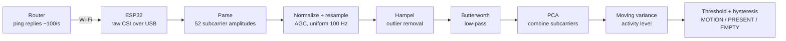
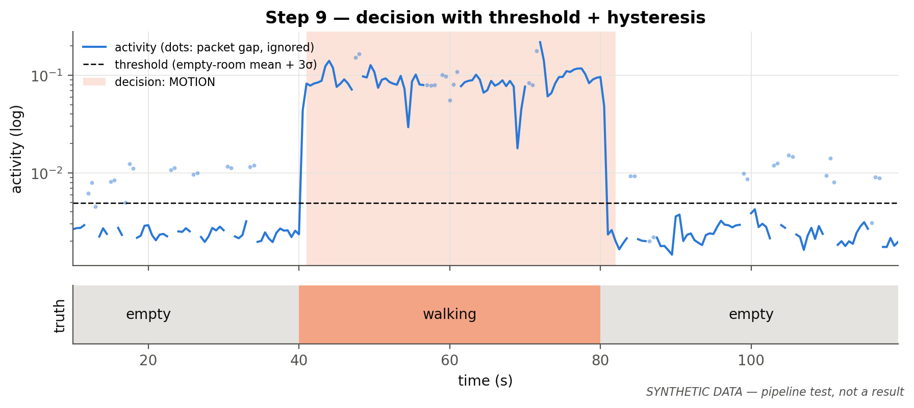

# Wi-Fi as a Sensor

**DSP-based human motion detection using ESP32 Channel State Information (CSI)**

Can a cheap Wi-Fi microcontroller tell whether someone is moving in a room, using only the
channel measurements it already makes in order to communicate?

Every Wi-Fi packet lets the receiver estimate the **channel state information (CSI)**: how each
of the 52 OFDM (orthogonal frequency-division multiplexing) subcarriers was attenuated and
phase-shifted on its way through the room. When nothing moves, the room behaves like a fixed
**LTI (linear time-invariant) system** and the CSI is the sampled frequency response H(k). When a
person walks through, the echoes change and H(k) varies from packet to packet. Each subcarrier's
amplitude over time becomes a signal sampled at the packet rate, and we process it with classic DSP.

The ESP32 only streams **raw** CSI. All the signal processing is our own, in Python. Espressif's
built-in detection library (`esp-radar`) is deliberately not used.

> Built for a Digital Signal Processing course (topic: DSP in communication systems).

## How it works



| # | Step | DSP concept |
|---|---|---|
| 1 | Router answers pings ~100 times per second | packet rate = sampling frequency |
| 2 | Wi-Fi chip estimates the channel for each packet | OFDM, FFT, channel estimation, 8-bit quantization |
| 3 | Laptop records labelled sessions over USB serial | data acquisition |
| 4 | Integers → complex CSI → amplitude; per-packet normalization; resampling | complex signals, interpolation |
| 5 | Hampel filter | non-linear (median) filtering |
| 6 | Butterworth low-pass | IIR design, zero-phase (offline) vs causal (live) filtering |
| 7 | Background removal + PCA (principal component analysis) | DC removal, combining noisy observations |
| 8 | 1 s moving variance of the top components | windowed statistics |
| 9 | Threshold calibrated on an empty room + hysteresis | detection in noise |
| 10 | Evaluation on labelled recordings + live demo | accuracy, false alarms, misses |

## Repository layout

```
firmware/
  csi_recv_router/     ESP32 firmware (Espressif's esp-csi example, router/ping mode)
  setup_esp_idf.sh     one-time ESP-IDF install
python/
  capture/             serial/replay data sources, labelled recorder, synthetic CSI generator
  pipeline/            parse, resample, hampel, filters, combine (PCA), measure, detect, core
  analysis/            evaluation + one checkpoint plot per pipeline step
  live/                real-time detection window
  tests/               pytest suite (includes real ESP32 sample output)
data/                  raw/ (recordings), processed/ (calibration files)
figures/               checkpoint plots
```

## Quick start (no hardware needed)

A simulator produces synthetic CSI in exactly the ESP32's output format (multipath room model with a
walking or sitting person, plus noise, quantization, AGC jumps, random phase, interference and
irregular packet timing), so the whole pipeline can run without a board.

```bash
cd python
pip install -r requirements.txt
python -m pytest -q                                   # tests

python -m capture.simulate --out ../data/synthetic    # generate synthetic sessions
python -m analysis.evaluate ../data/synthetic --calib ../data/synthetic/sim_empty_1.csv \
       --save-calib ../data/processed/calibration_synthetic.json
python -m live.live_detect --replay ../data/synthetic/sim_mixed_1.csv --calibrate 60
```

## With an ESP32

Hardware: one classic ESP32 dev board (2.4 GHz only) and a home router with its 2.4 GHz network on.
Place them 3–5 m apart at chest height.

1. Install ESP-IDF, then build and flash the firmware: see [`firmware/README.md`](firmware/README.md).
2. Record labelled sessions (empty / walking / sitting), evaluate, plot and run the live demo:
   see [`python/README.md`](python/README.md).

## Example: detection on a synthetic session



*Synthetic data: this checks that the code works; it is not a measured result.*

## Status

- [x] Firmware (router/ping mode) and ESP-IDF setup
- [x] Full Python pipeline, offline and live, with tests
- [x] Synthetic data generator, evaluation, checkpoint plots
- [ ] Real recordings with the ESP32
- [ ] Parameter tuning and results on real data
- [ ] Stretch goals: spectrograms, breathing rate, multiple receivers (ESP-NOW), zone localization

## Known limitations

- Motion is easy to detect; a person sitting perfectly still is hard.
- Pets, fans and moving curtains cause false alarms; results depend on the room.
- 20 MHz of bandwidth is too narrow to measure distance from echo delays indoors, and one antenna
  gives no angle of arrival.
- Raw CSI phase is unusable (TX and RX clocks are not synchronized), so only amplitude is used.

## Context

Wi-Fi sensing now has its own IEEE amendment, **802.11bf**, for presence detection, smart buildings
and wellness monitoring ([overview](https://arxiv.org/abs/2207.04859)). The same technique raises
obvious privacy questions: walls don't stop Wi-Fi.

## References

- [Espressif ESP-CSI](https://github.com/espressif/esp-csi)
- [ESP-IDF Wi-Fi CSI guide](https://docs.espressif.com/projects/esp-idf/en/latest/esp32/api-guides/wifi-driver/wifi-vendor-features.html#wi-fi-channel-state-information)

## License

MIT, see [`LICENSE`](LICENSE). The firmware in `firmware/csi_recv_router/` comes from Espressif's
esp-csi under Apache-2.0 (see `firmware/csi_recv_router/LICENSE-espressif`).
